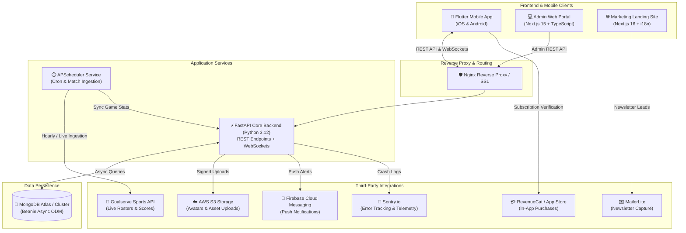

# 🏀 Mon5majeur — Real-Time Fantasy Basketball Ecosystem

<div align="center">


### *Next-Generation Fantasy Basketball · Real-Time Matchdays · Unified Monorepo*

[](https://fastapi.tiangolo.com)
[](https://python.org)
[](https://www.mongodb.com)
[](https://flutter.dev)
[](https://nextjs.org)
[](https://nextjs.org)
[](https://www.docker.com)
[](https://firebase.google.com)
[](https://sentry.io)

[Overview](#-overview) •
[Architecture](#-system-architecture) •
[Monorepo Structure](#-repository-structure) •
[Core Features](#-core-features--mechanics) •
[Quick Start](#-quick-start--local-development) •
[Environment Config](#-environment-configuration) •
[API Reference](#-api-endpoints-overview) •
[Deployment](#-production-deployment) •
[QA & Audits](#-qa-reports--documentation)

</div>

---

## 🌟 Overview

**Mon5majeur** (*French for "My Starting Five"*) is a competitive, high-frequency fantasy basketball platform. Users draft and manage dynamic 5-player starting rosters, participate in public and private tournaments with custom playoff brackets, activate tactical booster cards, buy in-app tokens, and experience live matchday scoring powered by real-time WebSocket streams and sports API synchronization.

This repository is organized as a unified, production-grade **monorepo** containing:
1. **FastAPI Backend (`Mon5majeur-Backend`)**: Asynchronous REST & WebSocket services with MongoDB/Beanie ODM, APScheduler background sync, and Sentry telemetry.
2. **Flutter Mobile Application (`mon5majeur_app-main`)**: Native iOS & Android cross-platform client with GetX state management, real-time live match ticker, and RevenueCat in-app subscriptions.
3. **Admin Web Dashboard (`mon5majeur-dashboard`)**: Modern administrative command center built with Next.js 15, React 19, TypeScript, and Chart.js/Recharts.
4. **Marketing Landing Page (`Mon5majeur-landing page`)**: High-converting web portal featuring Tailwind CSS v4, Framer Motion animations, multi-language internationalization (i18n), and MailerLite subscriber integration.

---

## 🏛 System Architecture

The Mon5majeur platform leverages an asynchronous, event-driven architecture designed to withstand high concurrency spikes during live basketball matchdays:



---

## 📂 Repository Structure

```
Mon5majeur/
├── Mon5majeur-Backend/          # Core FastAPI REST & WebSocket backend service
│   ├── app/                     # Main application package
│   │   ├── api/                 # Root API router aggregator
│   │   ├── core/                # Core configurations, JWT security, settings
│   │   ├── cron/                # Scheduled jobs (Goalserve sports data sync)
│   │   ├── database/            # MongoDB connection and Beanie initializers
│   │   ├── exceptions/          # Custom exceptions & global error handlers
│   │   ├── middleware/          # CORS, authentication, logging middlewares
│   │   ├── modules/             # Modular domain-driven features:
│   │   │   ├── analytics/       # System metrics & player performance logs
│   │   │   ├── auth/            # JWT, OTP verification, Google/Apple OAuth
│   │   │   ├── bonuses/         # In-game booster cards & quotas
│   │   │   ├── competitions/    # Match fixtures, matchday generation
│   │   │   ├── files/           # AWS S3 media uploads (avatars, team logos)
│   │   │   ├── leagues/         # Public & private league lifecycle + playoffs
│   │   │   ├── lineups/         # Starting 5 selection & budget cap validator
│   │   │   ├── live_scores/     # WebSocket streaming & Goalserve ingestion
│   │   │   ├── notifications/   # Firebase Cloud Messaging (FCM) dispatch
│   │   │   ├── players/         # Athlete catalogs, credit valuation, game stats
│   │   │   ├── roles/           # Role-based access control (RBAC)
│   │   │   ├── tokens/          # Token wallet ledger & balance management
│   │   │   └── users/           # User profile models, avatars, and settings
│   │   └── utils/               # Common helper utilities
│   ├── tests/                   # Pytest unit, integration, and fixtures suite
│   ├── docker/                  # Nginx configuration and deployment scripts
│   ├── docker-compose.yml       # Local development multi-container orchestration
│   ├── docker-compose.prod.yml  # Production deployment stack with Nginx & SSL
│   ├── Dockerfile               # Backend container recipe
│   ├── Makefile                 # Developer CLI shortcuts (lint, test, run)
│   ├── pyproject.toml           # Ruff & tooling configuration
│   └── requirements.txt         # Production Python dependencies
│
├── mon5majeur_app-main/         # Flutter Mobile App (iOS / Android)
│   ├── lib/
│   │   ├── controllers/         # GetX business logic and state controllers
│   │   ├── core/                # Constants, themes, network clients, base widgets
│   │   ├── data/                # Remote API providers, repositories, models
│   │   ├── presentation/        # UI layer organized by feature:
│   │   │   ├── authentication/  # Login, Sign Up, OTP, Social Auth screens
│   │   │   ├── home/            # Dashboard, live scores ticker, match preview
│   │   │   ├── mymatch/         # League rankings, team builder, head-to-head
│   │   │   ├── profile/         # User profile, wallet balance, edit settings
│   │   │   ├── shop/            # Token shop, booster cards, in-app purchases
│   │   │   └── tutorial/        # Onboarding interactive walkthrough
│   │   └── utils/               # Formatters, screen responsive utilities
│   ├── assets/                  # High-resolution graphics, team badges, SVGs
│   └── pubspec.yaml             # Flutter dependencies & platform manifest
│
├── mon5majeur-dashboard/        # Administrator Portal (Next.js 15 + TypeScript)
│   ├── src/
│   │   ├── app/                 # Next.js App Router
│   │   │   ├── adminDashboard/  # Core admin modules:
│   │   │   │   ├── analytics&reporting/       # Visual KPIs, engagement graphs
│   │   │   │   ├── bonus&storeManagement/     # Booster cards catalog & pricing
│   │   │   │   ├── leagueManagement/          # Private/public league moderation
│   │   │   │   ├── match&scoreManagement/     # Live score monitoring & sync
│   │   │   │   ├── security&compliance/       # Audit logs & role assignments
│   │   │   │   ├── userManagement/            # User account moderation & bans
│   │   │   │   └── settings/                  # Global system configuration
│   │   │   ├── singin/          # Admin authentication screen
│   │   │   └── forgetPassword/  # Password reset flow
│   │   └── components/          # Reusable UI widgets, modals, charts, tables
│   ├── package.json             # Next.js 15, React 19, Tailwind CSS dependencies
│   └── tsconfig.json            # Strict TypeScript configuration
│
├── Mon5majeur-landing page/     # Public Marketing Site (Next.js 16 + i18n)
│   ├── src/
│   │   ├── app/                 # Next.js App Router (Landing, Privacy, Terms)
│   │   └── components/          # Animated heroes, testimonials, feature showcases
│   └── package.json             # Next.js 16, Motion, Tailwind CSS v4, i18next
│
├── docs/                        # Specifications, QA Audits & Design Assets
│   ├── design-assets/           # Player jerseys, booster cards, match graphics
│   ├── qa-reports/              # Client QA audit reports (PDF & CSV logs)
│   └── specs/                   # Infrastructure & security architecture specs
└── scripts/                     # Monorepo maintenance & git hook automation scripts
```

---

## ⚡ Core Features & Mechanics

| Feature | Description | Implemented In |
| :--- | :--- | :--- |
| **Starting Five Roster** | Select exactly 5 professional players respecting strict positional constraints (Point Guard, Shooting Guard, Small Forward, Power Forward, Center) and salary/credit caps. | `Flutter App`, `Backend API` |
| **Real-Time Live Ticker** | Bidirectional WebSocket connection broadcasting live match statistics (points, rebounds, assists, blocks, steals, fouls) and auto-updating fantasy points. | `FastAPI (WebSockets)`, `Flutter` |
| **Leagues & Playoff Brackets** | Join public matchday pools or create private leagues protected with passcodes. Automatic fixture generation, round-robin stages, and knockout playoffs. | `Backend`, `Flutter`, `Dashboard` |
| **Token Economy & Shop** | Virtual in-app wallet (`TokenWallet`). Users acquire tokens through gameplay or in-app purchases to buy performance boosters (e.g. Captain 2x booster). | `FastAPI`, `RevenueCat`, `Flutter` |
| **Authentication & RBAC** | Email signup with secure One-Time Password (OTP) verification, native Google OAuth and Apple Sign-In, plus granular Role-Based Access Control. | `FastAPI`, `Flutter`, `Dashboard` |
| **Administrative Control** | Full CMS and analytics portal for user moderation, league management, credit adjustment, and manual live score corrections. | `Next.js 15 Dashboard` |
| **Push Notifications** | Instant alerts for roster lock deadlines, matchday kickoffs, head-to-head results, and friend invites via Firebase Cloud Messaging. | `FastAPI`, `Firebase FCM` |

---

## 🚀 Quick Start & Local Development

### 1. Prerequisites

Ensure the following tools are installed on your workstation:
- **Python**: `v3.12+`
- **Node.js**: `v18.0.0+` (or `v20 LTS`) with `npm` or `pnpm`
- **Flutter SDK**: `v3.10.x+` (with Android Studio / Xcode configured)
- **MongoDB**: `v6.0+` (local instance or MongoDB Atlas cluster)
- **Docker & Docker Compose**: (Optional, recommended for isolated setup)

---

### 2. Backend Service (`Mon5majeur-Backend`)

```bash
# 1. Navigate to the backend directory
cd Mon5majeur-Backend

# 2. Create and activate a Python virtual environment
python -m venv venv

# On macOS/Linux:
source venv/bin/activate
# On Windows (PowerShell):
.\venv\Scripts\Activate.ps1
# On Windows (cmd.exe):
.\venv\Scripts\activate.bat

# 3. Install dependencies
pip install -r requirements.txt
pip install -r requirements-dev.txt   # Optional: development & test tools

# 4. Configure environment variables
cp .env.example .env
# Edit .env with your MongoDB URI, JWT Secret, and credentials

# 5. Launch the local development server
uvicorn app.main:app --host 0.0.0.0 --port 8000 --reload
```

* The interactive Swagger API documentation will be available at: **[http://localhost:8000/docs](http://localhost:8000/docs)**
* Alternative ReDoc documentation: **[http://localhost:8000/redoc](http://localhost:8000/redoc)**

---

### 3. Administrator Dashboard (`mon5majeur-dashboard`)

```bash
# 1. Navigate to dashboard directory
cd mon5majeur-dashboard

# 2. Install dependencies
npm install

# 3. Setup environment
cp .env.example .env.local
# Set NEXT_PUBLIC_API_URL=http://localhost:8000/api

# 4. Start the development server
npm run dev
```

* Access the admin portal at: **[http://localhost:3000](http://localhost:3000)**

---

### 4. Marketing Landing Page (`Mon5majeur-landing page`)

```bash
# 1. Navigate to landing page directory
cd "Mon5majeur-landing page"

# 2. Install dependencies
npm install

# 3. Setup environment
cp .env.example .env.local

# 4. Run development server on port 3001
npm run dev -- -p 3001
```

* Access the landing page at: **[http://localhost:3001](http://localhost:3001)**

---

### 5. Mobile Application (`mon5majeur_app-main`)

```bash
# 1. Navigate to the mobile app directory
cd mon5majeur_app-main

# 2. Fetch Flutter packages
flutter pub get

# 3. Configure API target
# Open lib/data/services/api_url.dart and verify the base URL:
# static const baseUrl = "http://10.0.2.2:8000/api"; // For Android Emulator
# static const baseUrl = "http://localhost:8000/api";  // For iOS Simulator

# 4. Run the app on an active emulator or connected device
flutter run
```

---

## 🐳 Running with Docker Compose

To spin up the backend API and MongoDB in a synchronized container environment:

```bash
cd Mon5majeur-Backend

# Start all containers in detached mode
docker compose up -d --build

# View real-time container logs
docker compose logs -f api

# Stop all containers
docker compose down
```

---

## ⚙️ Environment Configuration

### Backend Environment Variables (`Mon5majeur-Backend/.env`)

| Variable | Description | Default / Example |
| :--- | :--- | :--- |
| `APP_NAME` | Service identifier | `Mon5majeur API` |
| `ENVIRONMENT` | Deployment environment (`development` / `production`) | `development` |
| `DEBUG` | Enable debug logs and auto-reload | `true` |
| `SECRET_KEY` | Cryptographic secret for signing JWT tokens | *32+ character random string* |
| `ALGORITHM` | JWT hashing algorithm | `HS256` |
| `ACCESS_TOKEN_EXPIRE_MINUTES` | Access token lifespan | `30` |
| `MONGODB_URI` | MongoDB connection string | `mongodb://localhost:27017` |
| `MONGODB_DB_NAME` | Database name | `mon5majeur_db` |
| `BACKEND_CORS_ORIGINS` | Allowed origins (comma-separated) | `http://localhost:3000,http://localhost:3001` |
| `AWS_ACCESS_KEY_ID` | Amazon S3 access key ID | *Your AWS Key* |
| `AWS_SECRET_ACCESS_KEY` | Amazon S3 secret access key | *Your AWS Secret* |
| `AWS_STORAGE_BUCKET_NAME` | Amazon S3 storage bucket name | `mon5majeur-media` |
| `AWS_S3_REGION_NAME` | Amazon S3 region | `eu-north-1` |
| `SOCIAL_AUTH_GOOGLE_CLIENT_ID` | Google OAuth Client ID | *Google OAuth ID* |
| `GOALSERVE_API_KEY` | Goalserve Sports Data API key | *Sports feed API key* |
| `FCM_CREDENTIALS_PATH` | Path to Firebase admin service account key | `/app/secrets/firebase-service-account.json` |
| `SENTRY_DSN` | Sentry project DSN for error telemetry | *https://...@sentry.io/...* |
| `ENABLE_SCHEDULER` | Toggle APScheduler background cron tasks | `true` |

### Dashboard Environment Variables (`mon5majeur-dashboard/.env.local`)

| Variable | Description | Example |
| :--- | :--- | :--- |
| `NEXT_PUBLIC_API_URL` | Base HTTP endpoint for the backend API | `http://localhost:8000/api` |

---

## 🔌 API Endpoints Overview

The backend exposes a structured, RESTful interface alongside real-time WebSockets:

| Category | Method & Route | Description |
| :--- | :--- | :--- |
| **Authentication** | `POST /api/auth/register/` | Register pending user and dispatch email OTP |
| | `POST /api/auth/verify-otp/` | Validate OTP code and activate account |
| | `POST /api/auth/login/` | Exchange credentials for JWT access & refresh tokens |
| | `POST /api/auth/google/` | Authenticate or sign up via Google OAuth token |
| | `POST /api/auth/apple/` | Authenticate or sign up via Apple Identity token |
| **User Profiles** | `GET /api/UserProfiles/` | Fetch current authenticated user's profile |
| | `PUT /api/UserProfiles/{id}/` | Update avatar, nickname, favorite team, password |
| **Private Leagues** | `POST /api/private-leagues/` | Create a private league with passcode protection |
| | `POST /api/private-leagues/join/` | Join an existing league with room passcode |
| | `GET /api/private-leagues/my_leagues/` | Fetch all leagues the user belongs to |
| | `POST /api/private-leagues/start_league/` | Lock roster submissions and generate playoff brackets |
| **Rosters & Games** | `GET /api/players-today/` | Retrieve athlete roster eligible for current matchday |
| | `POST /api/private-leagues/{id}/{matchday}/players-selection/` | Submit starting five lineup with captain & boosters |
| | `GET /api/private-leagues/matches/{id}/{matchday}/` | Retrieve head-to-head matchday scores |
| **Tokens & Boosters** | `GET /api/tokens/wallet/` | Retrieve user token balance and transaction history |
| | `POST /api/bonuses/activate/` | Apply booster card to a specific player/matchday |
| **WebSockets** | `WS /ws/live-scores/{match_id}` | Stream real-time play-by-play and fantasy score updates |

---

## 🧪 Testing & Code Quality

### Backend Quality Suite
```bash
cd Mon5majeur-Backend

# Run test suite with code coverage
pytest tests/ -v --cov=app --cov-report=term-missing

# Lint code with Ruff
ruff check .

# Automatically apply Ruff fixes
ruff check . --fix

# Type validation
mypy app --ignore-missing-imports
```

### Dashboard Quality Suite
```bash
cd mon5majeur-dashboard

# Run ESLint validation
npm run lint

# Validate production build output
npm run build
```

### Mobile App Quality Suite
```bash
cd mon5majeur_app-main

# Execute Flutter unit & widget tests
flutter test

# Analyze codebase for linting issues
flutter analyze
```

---

## 🛡️ Production Deployment

### Production Stack with Nginx & Docker Compose
The backend includes a production-ready multi-stage Docker deployment (`docker-compose.prod.yml`):
- **FastAPI Container**: Runs behind Gunicorn/Uvicorn workers.
- **Nginx Reverse Proxy**: Handles SSL/TLS termination, rate limiting, and WebSocket proxying (`Upgrade` / `Connection` headers).
- **Environment Isolation**: Production secrets mounted securely from `.env.prod`.

```bash
cd Mon5majeur-Backend
docker compose -f docker-compose.prod.yml up -d --build
```

### Web Frontends (Vercel / Netlify)
Both `mon5majeur-dashboard` and `Mon5majeur-landing page` are production-optimized for deployment on **Vercel**:
1. Connect this repository to Vercel.
2. Set the Root Directory to `mon5majeur-dashboard` or `Mon5majeur-landing page`.
3. Add environment variables (`NEXT_PUBLIC_API_URL`, etc.).
4. Deploy!

---

## 📑 QA Reports & Documentation

Comprehensive audits, QA validation logs, and architecture documentation are maintained in the repository:
- **[DESCRIPTION.md](file:///c:/Users/ittes/Desktop/Arik/Desktop/ARIK/Mon5majeur/DESCRIPTION.md)**: Exhaustive schema definitions, Beanie database models, and rulebook specifications.
- **`docs/qa-reports/`**:
  - `M5M_QA_Report_12_EN.pdf` & `M5M_QA_Report_13_EN.pdf`: QA audit recaps.
  - `M5M_QA_Dashboard_Admin_030926.pdf`: Admin portal QA validation report.
  - `M5M_QA12_duplicate_players.csv`: Ingestion reconciliation report.
- **`docs/specs/`**:
  - `Mon5Majeur_Audit_Infrastructure_Securite.pdf`: Infrastructure & security audit notes.

---

## 🤝 Contributing & Git Workflow

We enforce a structured Git workflow to ensure repository stability:

1. **Branch Naming**:
   - `feat/feature-name` (New features)
   - `fix/bug-description` (Bug fixes)
   - `chore/task-name` (Tooling, configs, dependency updates)
2. **Commit Messages**: Follow conventional commits (`feat: add starting five validator`, `fix: resolve websocket disconnect on matchday 4`).
3. **Pull Requests**: Ensure all linting checks pass before requesting review.

---

## 📄 License & Maintainers

* **Project**: Mon5majeur — Real-Time Fantasy Basketball Ecosystem
* **Copyright**: © 2026 Mon5majeur Team. All Rights Reserved.
* **Internal Documentation**: For private backend specs and production runbooks, see `docs/specs/`.

<div align="center">
<b>Built with passion for basketball fans worldwide 🏀</b>
</div>
